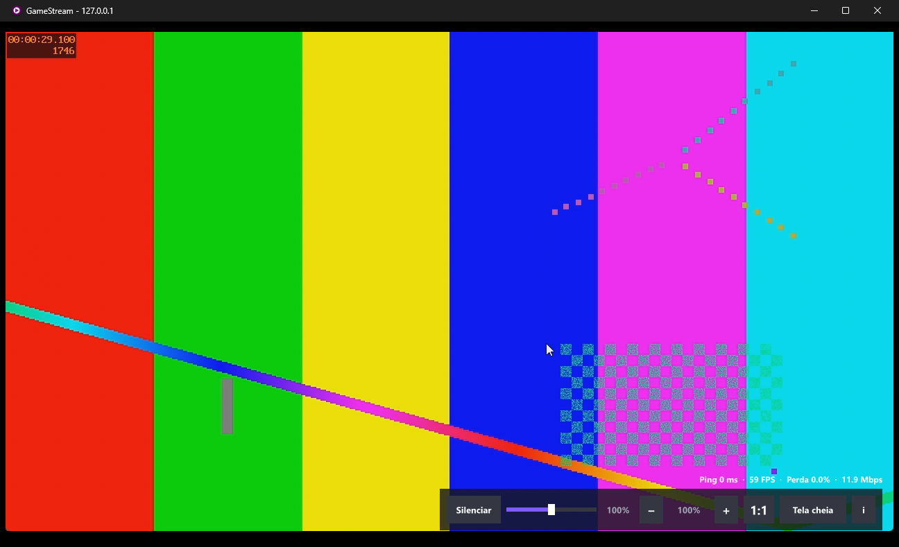
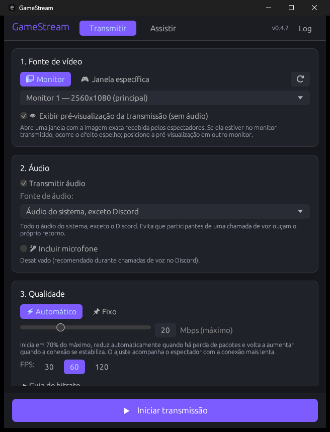
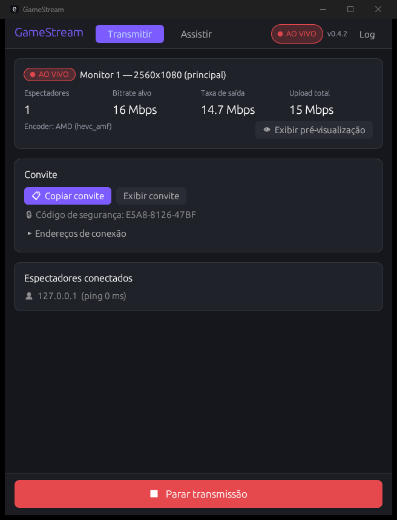
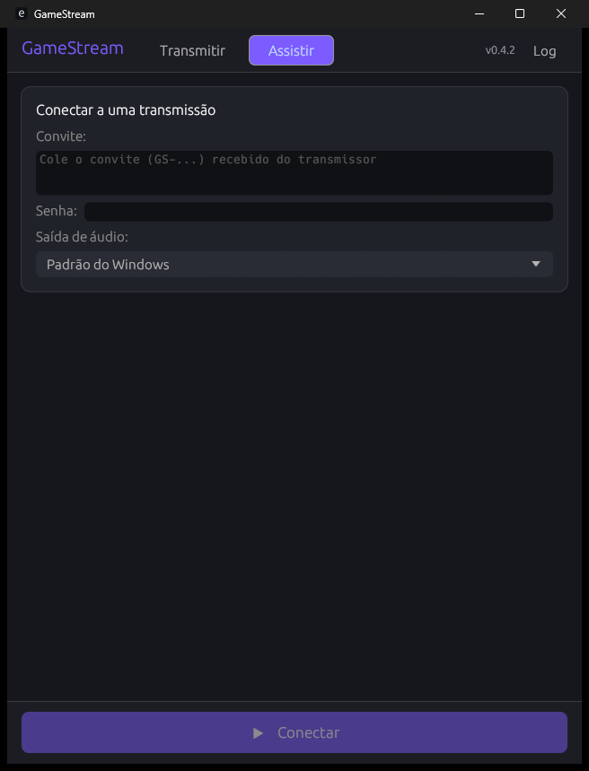

<div align="center">

# GameStream

**Transmissão de jogos e telas com baixa latência para Windows.**
Vídeo HEVC acelerado pela placa de vídeo, conexão direta e criptografada entre computadores, sem servidores intermediários e sem cadastro.

[](https://github.com/hnl09/gamestream/releases/latest)
[](https://github.com/hnl09/gamestream/releases)
[](LICENSE)


[**Baixar a versão mais recente**](https://github.com/hnl09/gamestream/releases/latest)

<sub>*Low-latency game and screen streaming for Windows (GPU-accelerated HEVC over encrypted QUIC). The interface is in Brazilian Portuguese.*</sub>



</div>

---

## Recursos

- **Baixa latência e alta qualidade**: vídeo HEVC codificado pela placa de vídeo (AMD, NVIDIA ou Intel, com detecção automática) e transmitido por QUIC/UDP.
- **Monitor ou janela específica**: a captura de janela é nativa do Windows e continua funcionando quando a janela é movida, redimensionada ou sobreposta.
- **Áudio sob controle**: transmita apenas o áudio do jogo ou todo o áudio do sistema **exceto o Discord**, evitando que participantes de uma chamada de voz ouçam o próprio retorno. Microfone opcional.
- **Vários espectadores ao mesmo tempo**: o vídeo é codificado uma única vez e distribuído a todos.
- **Bitrate adaptativo**: a qualidade se ajusta automaticamente à conexão dos espectadores, ou pode ser fixada manualmente.
- **Conexão sem configurar o roteador**: IPv6, UPnP ou VPN. O convite contém todos os endereços possíveis, e o espectador testa todos em paralelo.
- **Segurança**: criptografia TLS 1.3, verificação da identidade do transmissor pelo convite (proteção contra interceptação), senha e código de segurança.
- **Controles na janela de vídeo**: volume, zoom a partir do cursor, tela cheia e estatísticas em tempo real (ping, FPS, perda de pacotes e taxa recebida).
- **Pré-visualização local** da transmissão, sem áudio.
- **Atualização automática** com verificação de integridade.

<table>
  <tr>
    <td align="center"><br><sub>Configuração da transmissão</sub></td>
    <td align="center"><br><sub>Transmissão em andamento</sub></td>
    <td align="center"><br><sub>Conexão a uma transmissão</sub></td>
  </tr>
</table>

## Instalação

1. Baixe o **`GameStream.zip`** na página de [Releases](https://github.com/hnl09/gamestream/releases/latest) (em *Assets*).
2. Extraia o conteúdo para uma pasta com permissão de escrita (por exemplo, `Documentos\GameStream`).
3. Execute o **`gamestream.exe`**.

O aplicativo é portátil: não há instalador nem alterações no sistema. Para removê-lo, basta apagar a pasta.

> **Aviso do Windows SmartScreen:** por não possuir assinatura digital, o Windows pode exibir *"O Windows protegeu o computador"* na primeira execução. Clique em **Mais informações → Executar assim mesmo**. O código-fonte completo está neste repositório, e cada versão é compilada pelo GitHub Actions a partir dele.

## Requisitos

| | Transmissor | Espectador |
|---|---|---|
| **Sistema** | Windows 10 (versão 2004 ou superior) ou Windows 11, 64 bits | Windows 10 ou 11, 64 bits |
| **Placa de vídeo** | Encoder HEVC por hardware: AMD Radeon RX 400 ou superior, NVIDIA GeForce GTX 10 ou superior, Intel Core 6ª geração ou superior | Decodificação HEVC por hardware recomendada (praticamente todas as placas a partir de 2016) |
| **Conexão** | Upload ≥ bitrate × número de espectadores + 20% | Download ≥ bitrate + 30% |

Sem encoder HEVC por hardware, o transmissor usa codificação por CPU, com desempenho bastante inferior.

## Como usar

### Transmitir

1. Na aba **Transmitir**, escolha a fonte de vídeo (**Monitor** ou **Janela específica**) e a fonte de áudio.
2. Defina a qualidade (**Automático** é o recomendado) e uma **senha**.
3. Clique em **Iniciar transmissão**. Na primeira vez, o encoder de vídeo (FFmpeg, ~90 MB) é baixado automaticamente.
4. O convite (`GS-...`) é copiado para a área de transferência. Envie-o aos espectadores e informe a senha por um canal separado.

### Assistir

1. Na aba **Assistir**, cole o convite e informe a senha.
2. Clique em **Conectar**. O vídeo é exibido em uma janela própria.

| Na janela de vídeo | Ação |
|---|---|
| Mover o mouse | Exibe o painel de controles |
| Roda do mouse | Zoom a partir do cursor |
| Arrastar (com zoom) | Desloca a imagem |
| Botão do meio | Restaura o tamanho original |
| Duplo clique / `F` | Tela cheia |
| `M` · `9` · `0` | Silenciar · diminuir · aumentar volume |
| `I` | Fixa as estatísticas no canto da tela |

### Guia de bitrate

| Mbps | Qualidade esperada |
|---|---|
| 3–5 | 720p adequado; 1080p perde nitidez em movimentos rápidos |
| 8–10 | 1080p60 boa |
| 15 | 1080p60 muito boa **(recomendado)** |
| 20–25 | 1080p excelente / 1440p60 boa |
| 30–40 | 1440p excelente / 4K60 boa |
| 50–60 | 4K excelente (recomendado apenas em rede local) |

## Conexão pela internet

O GameStream conecta os computadores diretamente. O convite inclui todos os endereços disponíveis, e o espectador utiliza o primeiro que responder:

1. **IPv6**: oferecido pela maioria das operadoras. Se transmissor e espectador tiverem IPv6, a conexão costuma funcionar sem nenhuma configuração.
2. **UPnP**: o aplicativo solicita ao roteador a abertura automática da porta UDP 9000.
3. **VPN** ([Tailscale](https://tailscale.com) ou [Radmin VPN](https://www.radmin-vpn.com)): funciona em qualquer cenário, inclusive com CGNAT. Com todos na mesma rede virtual, o endereço da VPN entra no convite automaticamente.
4. **Redirecionamento manual** da porta **UDP 9000** no roteador.

Na primeira execução, permita o acesso do GameStream à rede quando o Firewall do Windows solicitar.

## Segurança e privacidade

- **Conexão criptografada**: vídeo, áudio e senha trafegam diretamente entre os computadores por QUIC com TLS 1.3.
- **Proteção contra interceptação**: o convite contém a impressão digital do certificado do transmissor; conexões com qualquer outro computador são recusadas. Transmissor e espectadores podem conferir o mesmo **código de segurança**.
- **Senha**: enviada somente após a verificação da identidade do transmissor. Cada tentativa incorreta é atrasada em 1 segundo.
- **Sem servidores, sem conta e sem coleta de dados**: a transmissão ocorre diretamente entre os computadores. Além dessa conexão, o aplicativo acessa apenas o GitHub (verificação de atualizações e download do FFmpeg) e o seu roteador (UPnP, se ativado).
- **Endereço IP**: como em qualquer conexão direta, os espectadores conseguem ver o endereço IP do transmissor. Para não expô-lo, utilize uma VPN.
- A identidade do transmissor é um certificado gerado localmente e armazenado em `%APPDATA%\GameStream`.

## Solução de problemas

<details>
<summary><b>"Tempo de conexão esgotado" ao conectar</b></summary>

Não há caminho de rede entre os computadores. Verifique se ambos têm IPv6, se o UPnP está ativo no roteador do transmissor ou utilize uma VPN (Tailscale ou Radmin VPN). Confirme também que o Firewall do Windows permitiu o GameStream.
</details>

<details>
<summary><b>A imagem trava ou apresenta artefatos</b></summary>

Use o modo de bitrate **Automático** ou reduza o bitrate. Confira a perda de pacotes nas estatísticas da janela de vídeo: valores acima de 2% indicam conexão instável (Wi-Fi fraco ou upload insuficiente do transmissor).
</details>

<details>
<summary><b>A janela capturada fica preta ou parada</b></summary>

Não minimize a janela transmitida. Em jogos, prefira o modo **janela sem bordas** (borderless) em vez de tela cheia exclusiva. Na captura de janela, o FPS diminui quando o conteúdo não muda; isso é esperado.
</details>

<details>
<summary><b>Os espectadores não ouvem o áudio</b></summary>

Em **Fonte de áudio**, selecione outra opção (por exemplo, o dispositivo de saída em que o jogo está tocando). Para testar a captura sem iniciar uma transmissão, execute `gamestream audio-test` no terminal.
</details>

<details>
<summary><b>O antivírus bloqueou o aplicativo</b></summary>

Executáveis sem assinatura digital podem gerar alertas falsos. Os binários são compilados pelo GitHub Actions a partir deste código-fonte, e cada versão publica o hash SHA-256 do `gamestream.exe`. Se preferir, compile o aplicativo a partir do código (veja abaixo).
</details>

## Linha de comando

Todas as funções também estão disponíveis pelo terminal:

```powershell
gamestream sources                                        # monitores, janelas e dispositivos de áudio
gamestream host --auto --bitrate 25 --password SENHA      # transmite o monitor principal
gamestream host --window "Nome da janela" --audio game    # transmite uma janela com o áudio dela
gamestream view GS-xxxx --password SENHA                  # conecta a uma transmissão
gamestream audio-test --audio no-discord                  # mede o áudio capturado
gamestream update                                         # atualiza para a versão mais recente
```

Use `gamestream --help` ou `gamestream <comando> --help` para ver todas as opções.

## Compilação a partir do código-fonte

Requisitos: [Rust](https://rustup.rs) (toolchain MSVC) e Visual Studio Build Tools com C++. Para testes locais, `ffmpeg` e `mpv` no PATH.

```powershell
git clone https://github.com/hnl09/gamestream.git
cd gamestream
$env:CARGO_TARGET_DIR = "$env:USERPROFILE\.gamestream-target"   # evita erros de caminho longo no Windows
cargo build --release
.\empacotar.ps1   # gera dist\ (teste local) e out\ (arquivos de release)
```

### Arquitetura

```
TRANSMISSOR                                                 ESPECTADOR (×N)
ddagrab / gfxcapture (GPU) ─► HEVC AMF/NVENC/QSV (FFmpeg) ─► QUIC ─► mpv (decodificação por hardware)
WASAPI (por aplicativo + microfone) ─► mixer ─────────────► QUIC ─► cpal (buffer de jitter ~40 ms)
```

| Módulo | Função |
|---|---|
| `src/host.rs` | encoder, distribuição aos espectadores, controle de bitrate |
| `src/viewer.rs` | conexão (múltiplos endereços), player, estatísticas |
| `src/net.rs` | QUIC/TLS, identidade persistente, verificação por pinning |
| `src/invite.rs` | convites, endereços locais/IPv6/VPN, UPnP |
| `src/sources.rs` | monitores e janelas |
| `src/audio.rs` · `src/procaudio.rs` | captura, mixagem e reprodução de áudio; captura por aplicativo |
| `src/updater.rs` | atualização automática e download do FFmpeg |
| `src/gui.rs` | interface gráfica (egui) |
| `assets/overlay.lua` | painel da janela de vídeo |

### Publicação de versões

Ao enviar uma tag `v*` (por exemplo, `git tag v0.5.0 && git push origin v0.5.0`), o GitHub Actions compila e publica `GameStream.zip`, `gamestream.exe` e `ffmpeg.exe.gz`, cada um com o respectivo arquivo `.sha256`.

## Contribuições

Relatos de problemas e sugestões são bem-vindos na aba [Issues](https://github.com/hnl09/gamestream/issues). Ao relatar um problema, inclua a versão do aplicativo e o conteúdo do **Log** (botão no canto superior direito → *Copiar log*), removendo endereços IP e convites.

## Licença

Distribuído sob a licença [MIT](LICENSE).

O pacote de distribuição utiliza o [FFmpeg](https://ffmpeg.org) e o [mpv](https://mpv.io), executados como processos separados e licenciados sob a GPL. Consulte [THIRD-PARTY.txt](THIRD-PARTY.txt).

Utilize o GameStream de acordo com a legislação aplicável e com os termos de uso do conteúdo transmitido.
